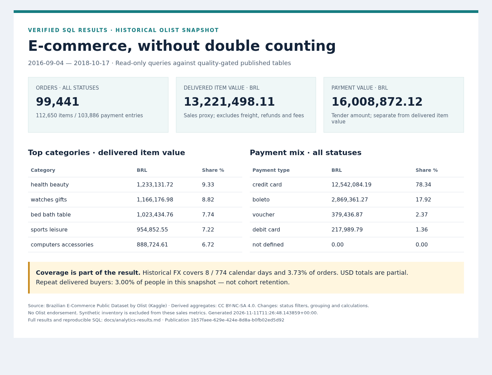
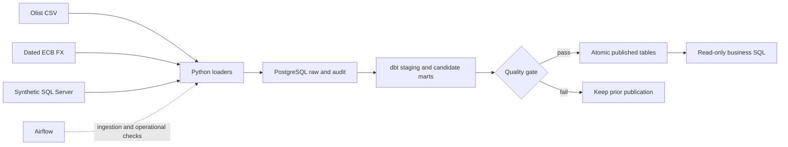
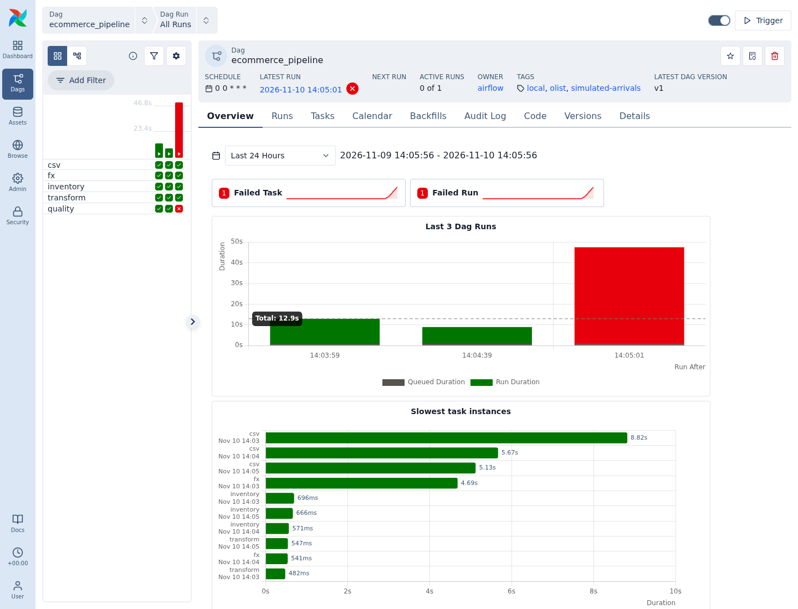

# E-Commerce Data Platform

A local data engineering portfolio that combines historical Brazilian e-commerce
orders, dated exchange rates and synthetic SQL Server inventory into a validated
PostgreSQL warehouse. The central problem is correctness: an order can have several
items and several payments, so joining those rows directly can multiply money.

The implementation demonstrates transactional ingestion, idempotent replay,
corrections/deletes, Airflow recovery, dbt dimensional modeling, quality-gated
publication, hosted CI and reproducible business SQL. Dimensional dbt publication
runs explicitly in WSL; the current Airflow DAG orchestrates ingestion and its
operational summary/checks.

## Results to inspect first

| Verified result | Evidence |
|---|---|
| 99,441 orders; 112,650 items; 103,886 payment entries | [Eight business questions and actual results](docs/analytics-results.md) |
| BRL 13,221,498.11 delivered-item sales proxy | [Revenue definition and quality rules](docs/data-quality.md) |
| 110 dbt quality tests; invalid candidates preserve prior publication | [Failure/correction evidence](docs/phase6-evidence.json) |
| 54 automated tests; hosted unit and PostgreSQL integration jobs passed | [GitHub Actions run](https://github.com/rulnin/ecommerce-data-platform/actions/runs/43006266346) |
| Full replay median 76.2 s; daily replay median 5.0 s on the measured WSL host | [All benchmark samples and limits](docs/benchmarks.md) |
| Warehouse restore matches all 153 user tables | [Backup evidence](docs/phase8-evidence.json) |

Revenue is delivered-order item value excluding freight, refunds, fees and taxes,
not accounting recognized revenue. Payment value is independent tender amount.
FX coverage is only 8/774 calendar days (3.73% of orders); USD totals are partial.
The snapshot covers 2016–2018, not current Olist operations. First/last months are
partial periods; repeat-buyer share is not cohort retention.



## Architecture and model



See the [execution boundaries](docs/architecture.md) and
[logical ERD with grains](docs/data-model.md). Customer/product/seller/date
dimensions support separate item/payment facts and daily summaries. SQL Server
inventory is explicitly synthetic current state; it is not historical real stock.

Stack: Python **3.14.4**, PostgreSQL **17.11**, SQL Server **2022**, Airflow **3.4.0**,
dbt Core **1.12.6** / dbt-postgres **1.11.0**, Docker Compose, pytest and Ruff.
Host tooling uses an existing uv-created `.venv`; Airflow dependencies remain in
its container. No cloud account or paid service is required.

## Setup in WSL

Use the Linux filesystem, not `/mnt/c`. Verified host: Ubuntu 26.04.1 WSL2 x86_64,
Docker Engine 29.9.3, Compose v5.7.0 and about 11 GiB WSL RAM. Prerequisites are
Git, working Docker/Compose, the existing Python 3.14.4 and
[uv](https://docs.astral.sh/uv/getting-started/installation/). Do not replace system
Python or install Python 3.12. The old temporary uv installation is not required;
install uv persistently through its official instructions if it is absent.

```bash
git clone https://github.com/rulnin/ecommerce-data-platform.git
cd ecommerce-data-platform
python3.14 --version                 # 3.14.4
uv --version
docker info                         # must work in this WSL session
bash scripts/setup_venv.sh
source .venv/bin/activate
python -m pip install -r requirements-dbt.txt
python -m pip check
```

The setup script preserves/repairs an existing venv, prohibits Python downloads,
and seeds pip. Direct package versions are pinned; transitive dependencies are not
fully locked. [Python compatibility evidence](docs/python-compatibility.md) records
what was tested. Public remote content reflects the commits pushed there; local
Phase 8/9 work must be committed/published before a clean clone can include it.
Clean-clone release verification belongs to Phase 10 and is not claimed here.

Create `.env` without overwriting an existing configuration:

```bash
python - <<'PY'
from pathlib import Path
import secrets
p = Path('.env')
if not p.exists():
    p.write_text(Path('.env.example').read_text().replace(
        'POSTGRES_PASSWORD=\n', 'POSTGRES_PASSWORD=' + secrets.token_hex(24) + '\n'))
    p.chmod(0o600)
PY
docker compose config --quiet
docker compose up -d --wait postgres
```

`.env`, `.venv`, native driver files, CSVs and backups are ignored. Environment
variables override `.env`. Ports bind to localhost. Changing `.env` passwords does
not rotate credentials in an initialized database volume. Avoid printing rendered
Compose config or connection URLs. The developer DB role needs CREATEDB for the
disposable integration tests; production RBAC is outside this local demo.

## Load sources and publish

Download the public snapshot, compare its hashes with
[the reviewed manifest](docs/dataset-manifest.json), then load raw data:

```bash
python scripts/download_dataset.py
# If public download is unavailable: use --archive /path/to/downloaded.zip
python scripts/profile_dataset.py --input data/raw --output docs/source-profile.json
python -m src.ingestion.csv_pipeline --batch-id initial-full
python -m src.ingestion.api_ingestion --date 2017-11-25 --batch-id fx-demo
```

The downloader preserves identical files and refuses to overwrite differing ones.
Daily CSV slices are a simulation, not live CDC:

```bash
python -m src.ingestion.csv_pipeline --batch-id day-2017-11-24 \
  --start 2017-11-24 --end 2017-11-25
```

For the synthetic source, configure unique MSSQL_SA_PASSWORD and SQLSERVER_PASSWORD
in local `.env`. Start the source, install the project-local native driver, seed
100 mapped demo products, then ingest its committed outbox:

```bash
python -m pip install -r requirements-sqlserver.txt
bash scripts/setup_odbc.sh
docker compose --profile sqlserver up -d --wait sqlserver
python -m scripts.seed_synthetic_inventory
python -m src.ingestion.sqlserver_ingestion --batch-id stock-demo
```

The native-driver setup is explicitly for this verified Ubuntu 26.04 amd64 host;
see [source setup, credential and platform details](docs/sqlserver-source.md).
Do not reset its source sequence or a target cursor to hide an inconsistency.

Build and inspect dbt developer models; then run the separate quality-gated
publication command before executing consumer queries:

```bash
python scripts/dbt.py debug
python scripts/dbt.py build
python scripts/dbt.py docs generate
python scripts/dbt.py docs serve --host 127.0.0.1 --port 8081
# In another activated terminal, after stopping docs serve if preferred:
python -m src.quality.publication
python -m scripts.verify_phase9
```

Publication builds candidates, tests every enabled model/test and updates all seven
`published` tables in one transaction. Nonzero exit means publication did not
complete. Consumer queries use `published`, not developer/candidate marts. Review
[the report](docs/quality-report.json) and fix failed source contracts before replay.
The baseline drift gate expects the reviewed full snapshot; loading a small slice
into an otherwise empty warehouse does not satisfy that contract.

## Airflow and failure recovery

After source configuration, `bash scripts/airflow.sh setup` creates missing local
metadata secrets/database, builds the constrained image and starts services.
Open localhost:8080; admin credentials remain in `.env`. The DAG defaults paused,
has a historical date bound, retries and bounded task execution. See the
[Airflow runbook](docs/airflow.md) for manual dates, native backfill and failed-task
clearing. Do not expose the local development service publicly.



[Successful run](docs/screenshots/phase4-success.png) ·
[Recovered run](docs/screenshots/phase4-recovered.png) ·
[Recorded attempts](docs/phase4-evidence.json)

## Tests and repeatable evidence

```bash
bash scripts/check.sh unit            # no datasets, SQL Server, API or cloud
bash scripts/check.sh integration     # healthy Postgres, disposable test DBs
RUN_DB_TESTS=1 python -m pytest -q     # complete lightweight suite
```

Both CI jobs use these same check scripts for lint, format, compilation and tests.
[Testing scope/style](docs/testing.md) explains dependencies and cleanup. The hosted
run linked above verifies the Phase 7 test commit; it is not a claim that later
uncommitted documentation or scripts already passed hosted CI.

Heavier explicit verification commands are `python -m scripts.verify_phase5`,
`python -m scripts.verify_phase6`, and `python -m scripts.verify_phase8`. They
create disposable databases and may take several minutes; Phase 8 also retains
an ignored warehouse dump. Read their runbooks before invoking them. Phase 2/3
source evidence remains available without repeating completed source mutations.

## Operate and present

- [Business questions, observed findings and interpretation](docs/analytics.md)
- [Results linked to all eight SQL files](docs/analytics-results.md)
- [Trade-offs and current limits](docs/trade-offs.md)
- [Replay, backup/restore, resources and stop commands](docs/runbook.md)
- [Four-minute walkthrough and CV/LinkedIn drafts](docs/walkthrough.md)
- [Canonical checklist and implementation evidence](ECOMMERCE_DATA_PLATFORM_TASKS.md)

Stop heavier services with `bash scripts/airflow.sh stop`; PostgreSQL remains
available. `docker compose stop postgres` stops it while preserving its volume.
Never delete working volumes as a recovery shortcut. Use `deactivate` to leave
the host venv. No AWS deployment, HA, production SLA or fully automated dimensional
orchestration is claimed; see the trade-offs and remaining Phase 10 work.

## Dataset rights

Source: **Brazilian E-Commerce Public Dataset by Olist**, published on
[Kaggle](https://www.kaggle.com/datasets/olistbr/brazilian-ecommerce), whose publisher
lists [CC BY-NC-SA 4.0](https://creativecommons.org/licenses/by-nc-sa/4.0/).
Dataset-derived report aggregates retain attribution/noncommercial/share-alike
terms; adaptations are identified in [data rights](docs/data-rights.md). Raw CSVs
are downloaded locally and are not committed. Inventory is generated synthetic
data, not an Olist source. FX provider terms remain applicable. No company/private
data or proprietary assets are used, and no endorsement by Olist is implied.
