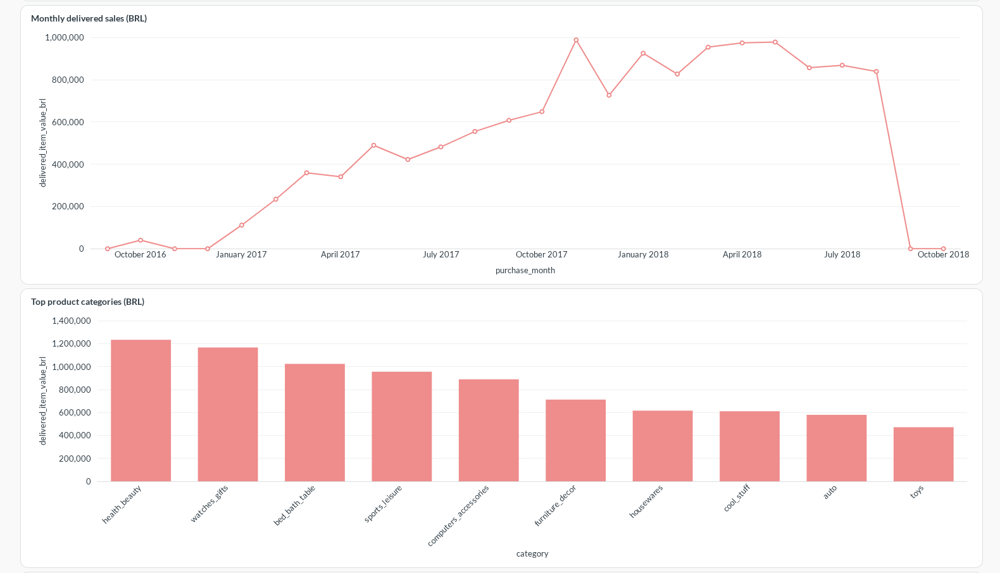

# E-Commerce Data Platform

A batch analytics pipeline for historical Olist orders, exchange rates, and
synthetic inventory. Python loads the sources into PostgreSQL; dbt validates
reporting tables before publication; Metabase displays the results. Airflow
automates the pipeline.

**[Quick start](docs/quickstart.md)** · [Deployment](docs/deployment.md) ·
[Architecture](docs/architecture.md) · [All documentation](docs/README.md)



## Run it

The full setup uses Docker Compose and a host Python environment. The supported
setup scripts target Ubuntu 26.04 x86_64 (including WSL2), Python **3.14.4**, and
uv. The recorded full-stack environment had about 11 GiB RAM.

Follow the [quick start](docs/quickstart.md) to configure passwords, start the
databases, load the sources, and open the dashboard. Airflow can be added afterward.
There is no one-command installer or verified production deployment.

| Component | Runs in | Purpose |
|---|---|---|
| PostgreSQL | Docker | Warehouse, audit data, Airflow and Metabase databases |
| SQL Server | Docker | Synthetic inventory source |
| Python and dbt | Host `.venv`; also inside Airflow | Load, transform, test, and publish data |
| Airflow | Docker | Orchestrate pipeline tasks |
| Metabase | Docker | Query published tables and display dashboards |

## Design

```text
Olist CSV + historical FX + synthetic SQL Server inventory
                         ↓
                 PostgreSQL raw data
                         ↓
                 dbt build and tests
                         ↓
                 Atomic publication
                         ↓
                 Metabase dashboard
```

- Separate item and payment facts prevent double counting.
- Transactional loaders and checkpoints make retries safe.
- Failed quality checks preserve the last published reporting tables.

See the [data model](docs/data-model.md), [quality rules](docs/data-quality.md),
and [design trade-offs](docs/trade-offs.md).

## Develop

With the project environment installed:

```bash
bash scripts/check.sh unit
# Requires PostgreSQL and permission to create disposable test databases:
bash scripts/check.sh integration
```

[Testing guide](docs/testing.md) · [Operations and backups](docs/runbook.md) ·
[Analytics and SQL](docs/analytics.md)

## Data and scope

This is a local demonstration using the historical 2016–2018
[Brazilian E-Commerce Public Dataset by Olist](https://www.kaggle.com/datasets/olistbr/brazilian-ecommerce),
under [CC BY-NC-SA 4.0](https://creativecommons.org/licenses/by-nc-sa/4.0/).
Derived reports adapt the data through typed joins, filtering, and aggregation.
Olist does not endorse this project.

Inventory is synthetic; FX coverage is partial. Delivered item value excludes
freight, refunds, fees, and taxes. Raw data, credentials, and backups are excluded
from Git. See [data attribution](docs/data-rights.md).
