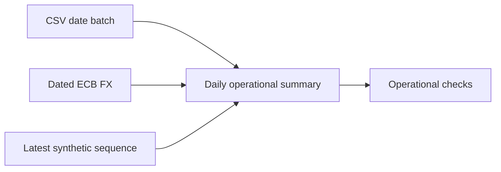

# Airflow orchestration — Phase 4

## Setup and access

Complete Phases 1–3 first: project venv, public CSVs, source volume and credentials
must exist. From the repository root:

```bash
bash scripts/airflow.sh setup
bash scripts/airflow.sh status
```

UI: http://localhost:8080, username admin, password AIRFLOW_ADMIN_PASSWORD in ignored
.env. Setup generates missing database/admin/JWT/Fernet secrets and preserves
existing ones; it does not rotate existing passwords. Metadata uses a separate
airflow_meta role/database on the existing PostgreSQL named volume. Task logs use
the airflow_logs named volume. DAG and raw-data mounts are read-only. Neither the
host venv nor Docker socket is mounted into Airflow.

```bash
bash scripts/airflow.sh start   # requires initial setup
bash scripts/airflow.sh logs airflow-scheduler
bash scripts/airflow.sh stop    # stops Airflow and SQL Server, preserves PostgreSQL/volumes
```

Keep .env with its persistent volumes. Never use down -v as routine cleanup.
Rebuild via setup after src/sql/Dockerfile changes; DAG edits are picked up by the
DAG processor. The verified stack is left running with the DAG paused.

## Runtime and isolation

docker-compose.airflow.yml defines API, scheduler and DAG processor services with
LocalExecutor. No Redis, Celery workers or triggerer are needed for these tasks.
Parallelism is 2; DAG limits are two active tasks and one active run. Memory caps
are API 1 GiB, scheduler 2 GiB, DAG processor 1 GiB; databases retain existing caps.
One verification observation measured about 1.3 GiB combined Airflow memory; that
is not a benchmark or guarantee.

Verified container: Python 3.14.4, Airflow 3.4.0, standard provider 1.21.0, FAB
provider 3.10.2, SQLAlchemy 2.0.55, psycopg/binary 3.3.6, pyodbc 5.3.0 and ODBC 18.7.1.1.
Metadata additionally uses psycopg2-binary 2.9.13. Pins are in airflow/requirements.txt
and Dockerfile, checked against the vendored official Python 3.14 constraints.
airflow-runtime.json records versions, image ID and constraint checksum. WSL pins
stay unchanged and isolated. Dimensional dbt models are still Phase 5 work.

The image uses python:3.14.4-slim-bookworm with a constrained installation. The first
full Airflow-image pull stalled on a large layer and Docker logged a BuildKit
session-health error, so a smaller custom image was used. Initial pip resolution
failed on pydantic-core 2.50.2 despite an available compatible wheel. A direct probe
succeeded; rebuilding with pip 26.3 and unchanged constraints passed. No constraints
were relaxed. The container installs its own Debian ODBC runtime, not WSL's .local.
Initial metadata startup also found a newline appended by the connection _CMD;
the URL helper now writes stdout without a trailing newline.

References: [Airflow install/constraints](https://airflow.apache.org/docs/apache-airflow/3.4.0/installation/installing-from-pypi.html),
[native backfill](https://airflow.apache.org/docs/apache-airflow/3.4.0/core-concepts/backfill.html).

## DAG behavior



The daily UTC schedule is bounded to the historical Olist period, starts
2016-09-04, ends at the 2018-10-18 bound, catchup=false and initially paused.
Native backfills use data_interval_start. Manual runs without a logical date must
provide conf.batch_date. Source partitions retain the original purchase-date text;
scheduling in UTC does not invent a source timestamp timezone. Inventory advances
its current source cursor, not historical stock time travel. FX keeps its actual
observation date separately from the requested day.

Tasks have two retries, initial delay 10 seconds with exponential backoff capped
at one minute, and five-minute execution timeouts. DAG timeout is 20 minutes.
metadata.orchestration_steps records run/task/date/attempt/status/timestamps and
source-run UUID. Bounded hashed source batch IDs link through that audit table.
Each source retains its own transaction/checkpoint semantics. A downstream failure
does not roll back already committed sources: recovery relies on idempotent replay.

Transform upserts staging.daily_ingestion_summary by date, with order/item/payment
counts and separate item/payment value aggregates. It never joins items and payments
at their lower grains. Quality checks successful source provenance, dated FX,
synthetic product mappings and a current-run operational summary. This is useful
operational transformation, not dimensional warehouse/dbt implementation, full
Phase 6 reconciliation, or mart-publication gating. Summary provenance updates on
rerun; source business counts/values stay stable.

## Trigger, backfill and recover

Unpause and trigger in the UI with:

```json
{"batch_date":"2017-11-24","failure_mode":"none"}
```

Native historical backfill, with the DAG unpaused:

```bash
docker compose -f docker-compose.yml -f docker-compose.airflow.yml --profile airflow \
  exec -T airflow-scheduler airflow backfill create --dag-id ecommerce_pipeline \
  --from-date 2017-11-25 --to-date 2017-11-26 --reprocess-behavior completed --max-active-runs 1
```

failure_mode=until_released deliberately fails quality through all three attempts
and fails the DAG without modifying source rows. To recover the known failed run:

```bash
.venv/bin/python -c "from src.orchestration.tasks import release; release('YOUR_DAG_RUN_ID')"
```

Clear only its failed quality task in the UI, enabling reset/restart of that DAG
run. Source/transform tasks stay successful and quality succeeds on attempt 4.
failure_mode=once demonstrates automatic retry. Release does not bypass the actual
quality function; genuine source/configuration issues must still be corrected.
Pause after demonstrations to prevent unintended scheduling.

## Reproduce verification and UI capture

```bash
source .venv/bin/activate
python -m scripts.verify_phase4
RUN_DB_TESTS=1 python -m pytest -q
```

For optional authenticated real-UI screenshots, start a temporary browser:

```bash
python -m pip install --target /tmp/ecommerce-cdp -r airflow/verification-requirements.txt
docker run -d --rm --name ecommerce-airflow-browser --network ecommerce-data-platform_default \
  -p 127.0.0.1:9222:9222 \
  chromedp/headless-shell@sha256:830fa77e0602cb42e5cb2cbd9237ba27b649ad69d5fb82b54713aac8b7ab4f29 \
  --remote-allow-origins=* --window-size=1440,1100
PYTHONPATH=/tmp/ecommerce-cdp python -m scripts.verify_phase4 --screenshots
docker stop ecommerce-airflow-browser
```

The browser is test-only, exposes CDP on localhost and is removed afterward. The
script captures actual PNGs, reads failed-attempt logs through the API and redacts
configured secrets. Evidence is written only after all checks pass. If the script
fails, inspect/pause the DAG before retrying. CLI FileType/optional Graphviz warnings
do not affect DAG execution or web graph rendering.

## Actual results

phase4-evidence.json records seven final successful DAG runs: success, a failed then
recovered run, same-day rerun, two explicit historical runs, and two native backfill
runs. There are 35 successful attempts and three failed quality attempts; quality
attempt 4 recovers. All five tasks in each final run are successful. CSV counts and
values, inventory counts and quantity sum remain stable. Tests pass 41/41 with DB
tests enabled; default tests skip seven opt-in DB checks.

| Day | Orders | Items | Payments | Item value BRL | Payment value BRL |
|---|---:|---:|---:|---:|---:|
| 2017-11-24 | 1,176 | 1,366 | 1,214 | 152,653.74 | 179,200.03 |
| 2017-11-25 | 499 | 580 | 538 | 60,923.48 | 71,897.01 |
| 2017-11-26 | 391 | 456 | 411 | 45,315.28 | 53,939.87 |

UI captures: [success](screenshots/phase4-success.png),
[failed](screenshots/phase4-failed.png), [recovered](screenshots/phase4-recovered.png).
Sanitized logs are in airflow-evidence/. Runtime version proof is airflow-runtime.json.
