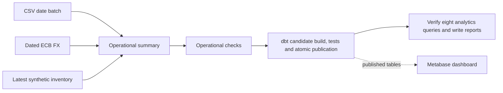

# Airflow pipeline

## Setup and access

Complete the README source setup first: load the full reviewed Olist snapshot,
configure FX and seed synthetic SQL Server inventory. Publication checks the full
snapshot baseline; a single day's data in an empty warehouse will fail the gate.

```bash
bash scripts/airflow.sh setup   # also rebuild after source/runtime changes
bash scripts/airflow.sh status
```

Open http://localhost:8080. Username: `admin`; password: `AIRFLOW_ADMIN_PASSWORD`
in ignored `.env`. Setup preserves existing secrets and databases.

```bash
bash scripts/airflow.sh start
bash scripts/airflow.sh logs airflow-scheduler
bash scripts/airflow.sh stop
```

Stop preserves PostgreSQL, SQL Server and Airflow volumes. Never use `down -v`
as routine cleanup. DAG edits are picked up automatically; source, SQL, dbt,
config or Dockerfile changes require `setup` to rebuild the image.

## Tasks and publication



Task IDs: `csv`, `fx`, `inventory`, `transform`, `quality`, `publish`, `analytics`.
The last two use the existing publication/verifier modules in `/opt/warehouse`,
a separate Python environment inside the Airflow image. Airflow's constrained
packages remain isolated. Publication failure blocks analytics and preserves the
previous published tables. Analytics failure happens after publication and does
not roll it back. Clear only the failed task after correcting its cause.

The DAG allows one active run, two concurrent tasks, two retries per task, and a
40-minute overall timeout. Publication has a 15-minute timeout; other tasks have
five minutes. Cooperating loaders/publications use advisory locks; do not run
manual warehouse builds or loaders concurrently with a pipeline run.

Reports produced by Airflow live in the persistent `airflow_reports` Docker volume,
not the host's `docs/` directory. To inspect the latest quality report:

```bash
docker compose -f docker-compose.yml -f docker-compose.airflow.yml --profile airflow \
  exec -T airflow-scheduler cat /opt/project/docs/quality-report.json
```

`metadata.orchestration_steps` records attempts for all seven tasks.
`metadata.quality_runs` records the publication result. Host commands remain
available for debugging; see [dbt](dbt-warehouse.md) and [quality](data-quality.md).

## Trigger a historical batch

The DAG starts paused, uses `@daily` with `catchup=false`, and is bounded to
2016-09-04 through 2018-10-18. It simulates historical arrivals, not today's feed.
Unpausing alone does not schedule current-day processing.

In the UI, unpause `ecommerce_pipeline`, choose **Trigger DAG**, and set both:

- Logical date: `2017-11-24T00:00:00+00:00`
- Configuration: `{"batch_date":"2017-11-24","failure_mode":"none"}`

Or run:

```bash
docker compose -f docker-compose.yml -f docker-compose.airflow.yml --profile airflow \
  exec -T airflow-scheduler airflow dags unpause ecommerce_pipeline

docker compose -f docker-compose.yml -f docker-compose.airflow.yml --profile airflow \
  exec -T airflow-scheduler airflow dags trigger ecommerce_pipeline \
  --logical-date '2017-11-24T00:00:00+00:00' \
  --conf '{"batch_date":"2017-11-24","failure_mode":"none"}'
```

November 25 and 26, 2017 also have source records. Change both dates together.
If a logical date already has a run, clear/replay that run or choose another date.
A current logical date can create an empty successful run with **no task instances**
because it exceeds the historical end date. Select the new historical run to
inspect task states and logs.

For native historical backfill with the DAG unpaused:

```bash
docker compose -f docker-compose.yml -f docker-compose.airflow.yml --profile airflow \
  exec -T airflow-scheduler airflow backfill create --dag-id ecommerce_pipeline \
  --from-date 2017-11-25 --to-date 2017-11-26 --reprocess-behavior completed --max-active-runs 1
```

Each backfilled batch rebuilds and publishes the complete persisted snapshot,
then verifies analytics. It does not publish only that day's slice. Inventory
tracks its latest committed source cursor, not historical stock time travel.

## Failure demonstrations and historical evidence

`failure_mode=once` fails operational quality on its first attempt to show retry.
`until_released` fails all three attempts. To recover that demonstration:

```bash
.venv/bin/python -c "from src.orchestration.tasks import release; release('YOUR_DAG_RUN_ID')"
```

Clear its failed `quality` task and downstream tasks in the UI. Genuine source
errors still need correction. Pause the DAG after demonstrations.

Original Phase 4 evidence (generated locally) and
[failed](screenshots/phase4-failed.png)/[recovered](screenshots/phase4-recovered.png)
screenshots document the earlier five-task pipeline, before publication and
analytics were added. They are historical evidence, not the current task graph.
`python -m scripts.verify_phase4` now checks all seven task IDs in each successful
run. It runs multiple full publications and updates the original evidence file;
use it deliberately rather than as a lightweight check.

See [Metabase setup](metabase.md) for the independently running dashboard service.
