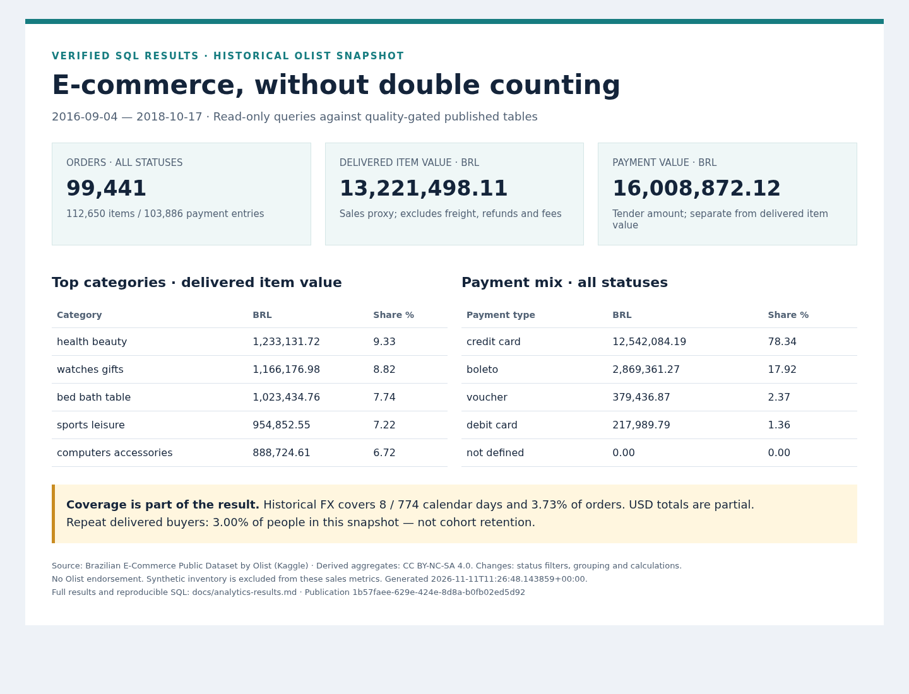

# Business SQL and verified results

Run `python -m scripts.verify_phase9` from the activated project venv after a
successful quality publication. The command is read-only, uses one repeatable-read
transaction, executes the eight files in sql/analytics and checks headline results
against independent raw source aggregates. It writes analytics-results.md, JSON
aggregates and phase9-evidence.json. It neither republishes data nor calls the API.
This verifier expects the reviewed snapshot and current raw/published agreement.



## Questions and interpretation

| Query | Business question | Reading the result |
|---|---|---|
| [01 overview](../sql/analytics/01_overview.sql) | What volume and delivered sales proxy does this snapshot contain? | All-status orders/items/tenders vs explicitly delivered item value |
| [02 monthly](../sql/analytics/02_monthly_sales.sql) | How does delivered item value vary by purchase month? | Delivered value per delivered order; empty calendar periods retained; edge months partial |
| [03 categories](../sql/analytics/03_top_categories.sql) | Which ten categories contribute most delivered item value? | Full-population value share before LIMIT; untranslated categories retained |
| [04 buyer states](../sql/analytics/04_buyer_states.sql) | Where do buyers contribute delivered value? | Buyer location, not seller origin, logistics attribution or market share |
| [05 payment mix](../sql/analytics/05_payment_mix.sql) | How are tender amounts distributed? | Payment value across all statuses, not revenue |
| [06 repeat buyers](../sql/analytics/06_repeat_buyers.sql) | What fraction of people have repeat delivered orders? | customer_unique_id after deduplicating orders; snapshot-wide, not cohort retention |
| [07 sellers](../sql/analytics/07_top_sellers.sql) | How concentrated is delivered value among seller ranks? | Anonymous deterministic ranks, full-population share; seller order counts overlap |
| [08 FX coverage](../sql/analytics/08_fx_coverage.sql) | How much of the snapshot has stored historical FX? | Covered days/orders/BRL alongside partial USD; missingness is visible |

The [complete result tables](analytics-results.md) and [JSON aggregates](analytics-results.json)
show actual values. In this publication:

- Delivered item value is BRL 13,221,498.11 versus BRL 16,008,872.12 in payment value.
  These are different definitions, not an unexplained reconciliation error.
- health_beauty leads categories at BRL 1,233,131.72 (9.33% of delivered item value).
- SP leads buyer states at BRL 5,067,633.16; this is observed snapshot distribution,
  not a causal explanation or a recommendation to expand/withdraw from a region.
- Credit cards represent 78.34% of tender value. The source's not_defined payment
  category is retained with zero amount rather than silently removed.
- 2,801 of 93,358 delivered buyers have repeat orders (3.00%). Identity is the
  anonymized customer_unique_id, not the per-order customer_id. Limited observation
  windows prevent interpreting this as long-term loyalty or retention.
- Stored FX covers 8/774 calendar days and 3,714/99,441 orders (3.73%). USD item
  value 144,161.08 is a **partial all-status** total, not complete USD revenue.

No query joins item rows to payment rows. All grouping/denominators are explicit;
financial arithmetic remains PostgreSQL numeric/Decimal. The first/last months
are incomplete snapshot periods. Rank and top-N lists are descriptive only.

## Reproduce the static screenshot and diagrams (optional)

The report itself requires only requirements.txt and PostgreSQL. The screenshot
is a static rendering of those query results; it is not a deployed dashboard or
live application. Diagram definitions remain native Mermaid in the Markdown.
Optional capture uses the existing digest-pinned ephemeral Chromium image,
Mermaid 11.4.1 loaded from its versioned CDN and websocket-client 1.9.0 installed
only under /tmp. It does not change project runtime requirements.

```bash
python -m pip install --target /tmp/ecommerce-phase9-cdp websocket-client==1.9.0
docker run --rm -d --name ecommerce-phase9-browser --memory=768m --shm-size=256m \
  -p 127.0.0.1:9222:9222 \
  chromedp/headless-shell@sha256:830fa77e0602cb42e5cb2cbd9237ba27b649ad69d5fb82b54713aac8b7ab4f29 \
  --remote-allow-origins=* --window-size=1440,1100
PYTHONPATH=/tmp/ecommerce-phase9-cdp:. python -m scripts.capture_portfolio
docker stop ecommerce-phase9-browser
```

Capture parses/renders all Mermaid blocks in README/architecture/data-model and
saves SVGs plus phase9-render-evidence.json. It generates the PNG directly from
analytics-results.json, with no database credentials in the browser, no source
rows, no filesystem mounts and no persistent web server. Internet access is
required only for the optional renderer's versioned Mermaid module. The browser
must be stopped after capture; its --rm container then disappears. Mermaid's
[official API](https://mermaid.js.org/config/usage) documents parse/render.

Dataset-derived aggregate report/screenshot content is attributed to Olist under
[CC BY-NC-SA 4.0](https://creativecommons.org/licenses/by-nc-sa/4.0/); see
[data rights and adaptations](data-rights.md). The diagram's architecture is this
project's implementation, not an Olist architecture or endorsement.
