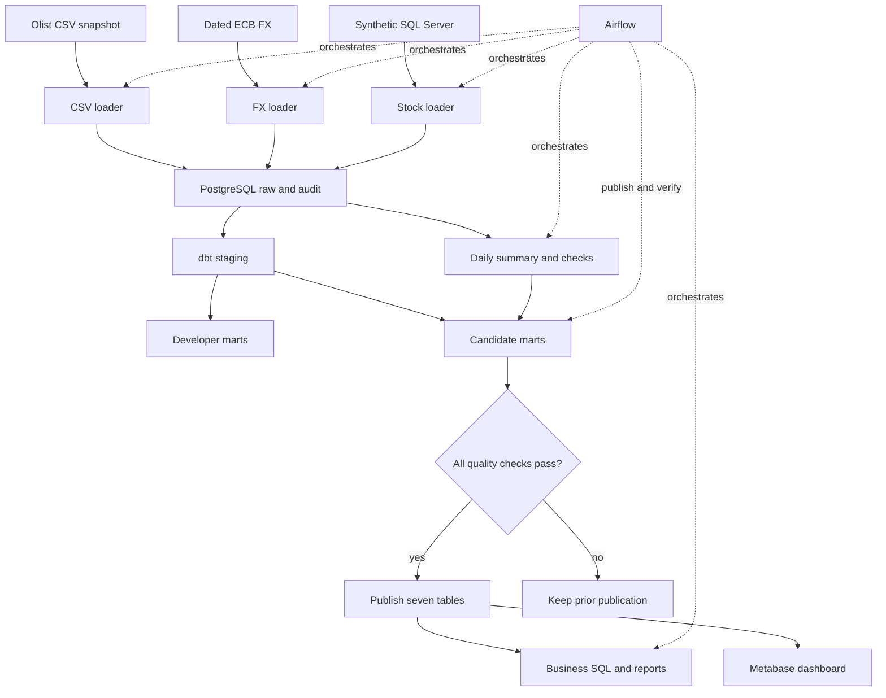
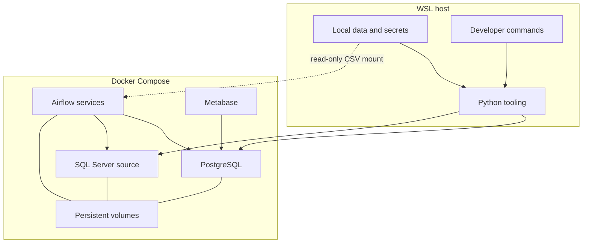

# Architecture and execution boundaries

This is a local portfolio implementation. Its heterogeneous sources, retries,
quality gate and operational evidence run locally; there is no deployed AWS
infrastructure or streaming source. PostgreSQL stores analytical data and a separate
Airflow metadata database. Source datasets and secrets stay outside Git.

The Airflow DAG runs ingestion → operational transform → operational quality →
warehouse publication → analytics verification. Publication invokes dbt in an
isolated environment and replaces all seven consumer tables in one transaction
only after every enabled model and test passes. Metabase runs independently and
reads `published` through a dedicated reporting login. A failed candidate leaves
the last good publication; a later analytics failure does not undo publication.

The host Python environment runs ingestion, dbt and pytest. Local CSVs, backups
and `.env` stay outside Git. Airflow runs its scheduler, API and DAG processor
with isolated dependencies. PostgreSQL stores the warehouse and separate
`airflow_meta` and `metabase_app` databases. Metabase uses a read-only warehouse
login. Named volumes retain database state, Airflow logs and generated reports.

Published tables and model grains: [data model](data-model.md). Source contracts:
[CSV](csv-ingestion.md), [FX](fx-contract.md), [SQL Server](sqlserver-source.md).
Recovery/resource/backup procedures: [runbook](runbook.md). The PostgreSQL warehouse
restore exercise covers neither SQL Server nor the separate Airflow/Metabase
application databases.
CI runs lightweight unit and disposable PostgreSQL integration tests; it does not
start the full Airflow stack or fetch public data.
