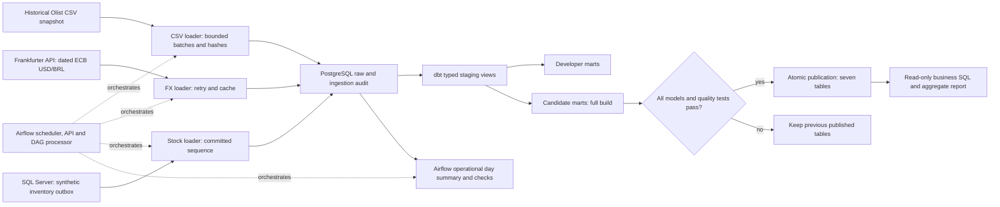
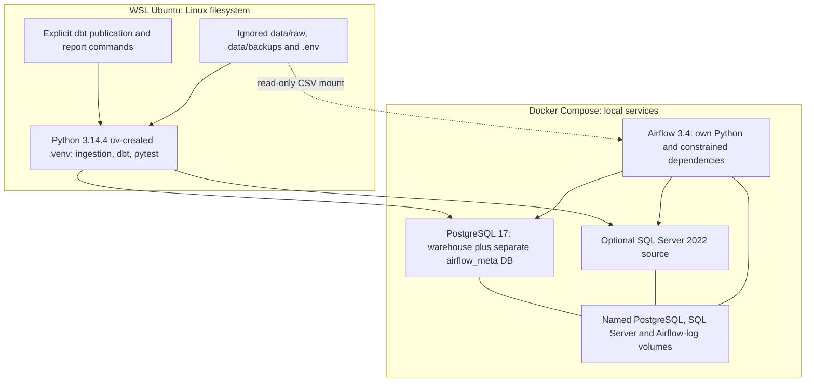

# Architecture and execution boundaries

This is a local portfolio implementation. Its heterogeneous sources, retries,
quality gate and operational evidence run locally; there is no deployed AWS
infrastructure or streaming source. PostgreSQL stores analytical data and a separate
Airflow metadata database. Source datasets and secrets stay outside Git.

The Airflow DAG implements ingestion → operational transform → operational quality,
with source tasks preceding transform/quality. It does **not** run dimensional dbt
or publish consumer marts. The explicit WSL `python -m src.quality.publication`
command builds candidates, tests every enabled model/test and publishes all seven
tables in one transaction. A failed candidate leaves the last good publication.
The architecture shows these actual boundaries rather than an unimplemented
end-to-end dbt operator.

Published tables and model grains: [data model](data-model.md). Source contracts:
[CSV](csv-ingestion.md), [FX](fx-contract.md), [SQL Server](sqlserver-source.md).
Recovery/resource/backup procedures: [runbook](runbook.md). The PostgreSQL warehouse
restore exercise covers neither SQL Server nor Airflow's separate metadata DB.
CI runs lightweight unit and disposable PostgreSQL integration tests; it does not
start the full Airflow stack or fetch public data.

Portable rendered copies: [data flow](diagrams/architecture-1.svg) and
[runtime boundaries](diagrams/architecture-2.svg). The same Mermaid definitions
were syntax-checked and rendered with Mermaid 11.4.1; see
[render evidence](phase9-render-evidence.json).
