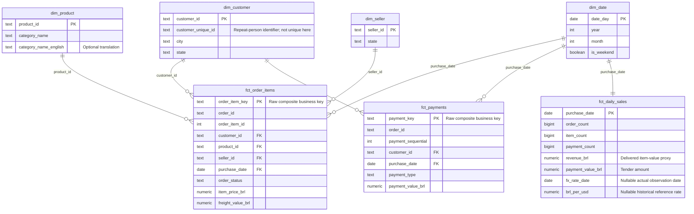

# Warehouse grains and logical ERD

The diagram describes tested logical business-key relationships. It does not
claim that dbt creates native PostgreSQL foreign-key constraints. Read validated
consumer tables from `published`; developer `marts` and `candidate_marts` are not
publication guarantees. Raw CSV attributes remain available in JSONB; staging
performs typed conversion and retains source keys/hashes.

| Relation | Grain | Important interpretation |
|---|---|---|
| dim_customer | customer_id | One order-associated customer key; customer_unique_id links repeat people |
| dim_product | product_id | Type 1 current attributes; untranslated categories preserved |
| dim_seller | seller_id | Type 1 current seller attributes |
| dim_date | Calendar day | Inclusive min/max purchase range; zero-order dates retained |
| fct_order_items | order_id + order_item_id | Price and freight at item grain, all statuses |
| fct_payments | order_id + payment_sequential | Independent payment entries, all statuses |
| fct_daily_sales | Purchase day | Independently aggregated orders/items/payments |

There is no direct item-to-payment relationship in the ERD. Their shared order_id
is a grouping key, not a one-to-one join key: two items and two payments would
produce four rows in a naive join. Aggregate each fact to the desired order/day
grain first, then join aggregates. Some orders have no item/payment records;
order volume comes from orders/daily summaries, not an item-fact count.

`revenue_brl` = delivered-order item prices by purchase day; excludes freight,
refunds, taxes and marketplace fees. This sales proxy is neither accounting
recognized revenue nor payment amount. Late corrections restate the affected
purchase date; no historical SCD Type 2 state is fabricated.

FX observations are BRL per USD, with the actual observed date and a maximum
seven-day backward fallback. Missing rates leave USD measures null. Sparse FX
coverage must accompany any partial USD sum. Purchase timestamps are source local
timezone-naive values; the project does not infer UTC timestamps or intraday FX.

Synthetic inventory/movements are current-state staging views with change_seq,
is_deleted and is_synthetic. Each product maps to the public product source,
including tombstones. They are not historical real stock facts and do not join to
purchase-day revenue. Reviews preserve content-key versions; geolocation preserves
distinct records instead of assuming ZIP uniqueness. These sources remain staging
rather than inventing unsupported dimension/fact semantics.

See [warehouse materialization and incremental rules](dbt-warehouse.md) and
[quality contracts](data-quality.md) for implementation details.

[Rendered ERD](diagrams/data-model-1.svg) is generated from the definition above.
